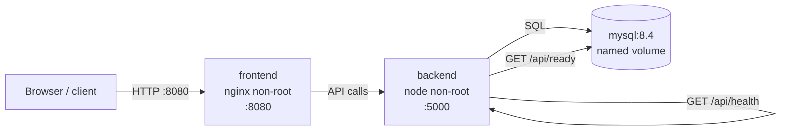
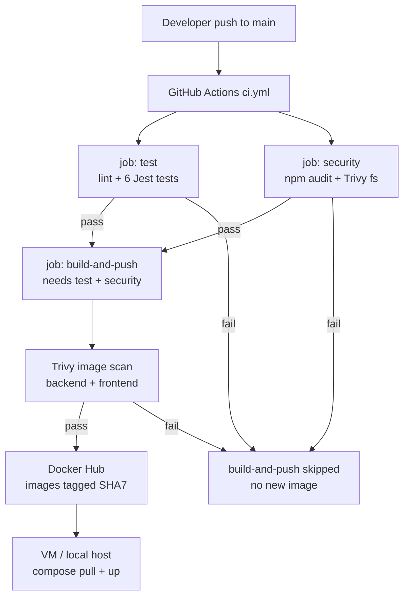

# BrightBank — Architecture & process

Maps to assessment items: package API in Docker → CI commit-to-release → Compose deploy → versioned rollback → observability.

## 1. Runtime architecture (deployed stack)

| Component | Image / process | Role | Privilege |
|-----------|-----------------|------|-----------|
| Frontend | `abmaxx/brightbank-frontend:<TAG>` | Static UI (nginx-unprivileged) | `nginx` |
| Backend | `abmaxx/brightbank-backend:<TAG>` | Express API, JSON logs | `node` |
| MySQL | `mysql:8.4` | Persistent store | managed by image; app uses DB user |

**Config:** root `.env` supplies `DOCKERHUB_USER`, `TAG`, and DB settings. Compose uses `image:` (not local `build:`) so the VM runs what CI published.

**Persistence:** MySQL data on a Docker volume so `compose down` / recreate keeps demo data.

**Health model:**
- `/api/health` — process up (liveness)
- `/api/ready` — DB reachable (readiness); 503 when MySQL is down

---

## 2. Commit → release process

**Release safety:** failed lint/tests/scans skip push → nothing new to deploy.  
**Versioning:** image tag = first 7 chars of `GITHUB_SHA` (e.g. `728bf68`, `a710df8`).  
**Rollback:** set `TAG` to previous SHA → `docker compose pull && docker compose up -d`.

---

## 4. Security boundaries (summary)

| Layer | Control |
|-------|---------|
| Image build | `.dockerignore` excludes `.env`, `node_modules`, `.git` |
| Runtime | Non-root `USER`; least-privilege DB user |
| CI | Secrets in GitHub Actions; Trivy + npm audit before push |
| Registry | Versioned tags; no “latest-only” deploy path |

---

## Diagram file

Same views as SVG for PDF/slide paste: [`architecture.svg`](architecture.svg).
